**AI Engineer based in Dubai.** I build production AI systems in Python: LLM pipelines, RAG and agents, and AI image generation. Currently building AI services at a marketplace company.

[LinkedIn](https://linkedin.com/in/pavithrahn56) | [Resume](https://drive.google.com/file/d/1MKYZkYATcADT_C3vD5PdLHhjKJFJ381U/view?usp=sharing) | [Kaggle](https://kaggle.com/pavithrahn) | pavithrahn56@gmail.com

### ✨ Current focus
- **Multilingual LLM pipelines:** English, Arabic and French output, with a second model fact-checking before anything is published
- **AI image generation:** consistent product-style images with automatic background removal
- **Production AI APIs:** FastAPI services with background jobs, tests and cost tracking on every call
- **Workflow automation:** n8n pipelines that join lead lists, spreadsheets and email into one flow
- **AI visibility:** how search engines and AI assistants read websites

### 🎀 Featured projects
- **[NewsAI](https://github.com/pavithra-hn/NewsAI):** quick reads and humanize rewrites for English, Arabic and French articles, with every figure checked after the rewrite. Multilingual LLM pipeline, Streamlit, Python
- **[Novacart Intelligence](https://github.com/pavithra-hn/Novacart-intelligence):** answers business questions with evidence by chaining orders, refunds, tickets, warehouse logs and email. RAG, hand-written ReAct agent, Python
- **[Synapse](https://github.com/pavithra-hn/Multimodel-AI-):** reads PDFs with text and vision together, so tables, charts and figures are not lost. Multimodal RAG, vision models, Python
- **[AI Code Debugger](https://github.com/pavithra-hn/-AI-Code-Debugger):** several agents find an error, write a fix and check it in a loop. Multi-agent LLM, Streamlit, Docker
- **[Realtime AI Backend](https://github.com/pavithra-hn/Realtime-AI-Backend-WebSockets-Supabase-):** live AI conversations over WebSockets. Async Python, WebSockets, Supabase

### 🛠️ Tech stack

| | |
|---|---|
| **Languages** |  |
| **AI and LLMs** |              |
| **ML and data** |        |
| **Backend** |     |
| **Databases** |  |
| **Frontend** |    |
| **Cloud and DevOps** |   |
| **Testing and automation** |          |
| **SEO and docs** |    |
| **Tools** |      |

